# Mullet Claude

**Business up front, party in the back.**

Omarchy on the Lenovo Yoga 9 2-in-1: a desktop and a tablet, built with
Claude.

A customised [Omarchy](https://omarchy.org) (Arch + Hyprland) setup for the
**Lenovo Yoga 9 2-in-1 14IPH11** (Intel Panther Lake, OLED touchscreen, pen).
Unfolded it's a polished desktop (the business). Fold the screen back and it
turns into a touch-first tablet (the party), with its own bar, launcher,
gestures, on-screen keyboard and auto-rotation.

Everything is user config. **Nothing under `/usr/share/omarchy` is modified**,
so `omarchy update` won't overwrite it. Built on Omarchy 4.0.x with Hyprland's
Lua config.

> Plugin ids start with `daa.`, which is just the local username (Omarchy's
> `plugin clone` prefixes clones with it). Rename freely.

---

## Contents

- [Screenshots](#screenshots)
- [Repo layout](#repo-layout)
- [Desktop mode](#desktop-mode)
- [Tablet mode](#tablet-mode)
- [Shared pieces](#shared-pieces)
- [Theming Qt, KDE and Catfish](#theming-qt-kde-and-catfish)
- [Hardware fixes for the Yoga 9 14IPH11](#hardware-fixes-for-the-yoga-9-14iph11)
- [File map](#file-map)
- [Installing](#installing)
- [Known quirks](#known-quirks)
- [Mullet Claude](#mullet-claude)

---

## Screenshots

### Desktop (the business)

| | |
|---|---|
|  Floating bar islands over the wallpaper |  Kitty dropdown (`SUPER + T`) with the fastfetch greeting |
| 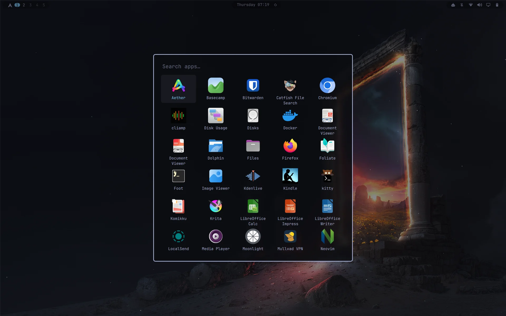 App launcher | 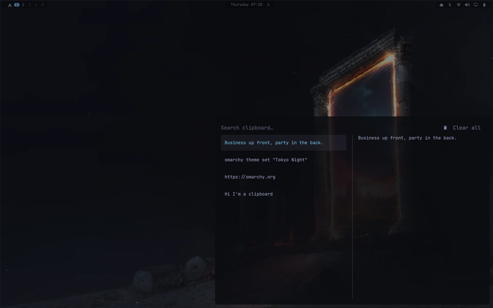 Clipboard, bottom-right, with Clear all |
|  Claude Code dropdown (`SUPER + C`), mid-screenshot session | 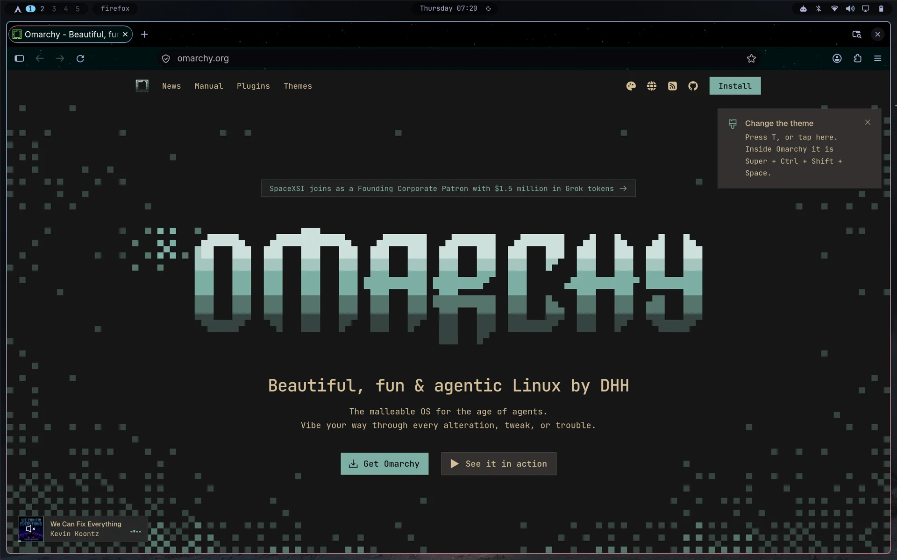 Firefox, themed from the Omarchy colours |
| 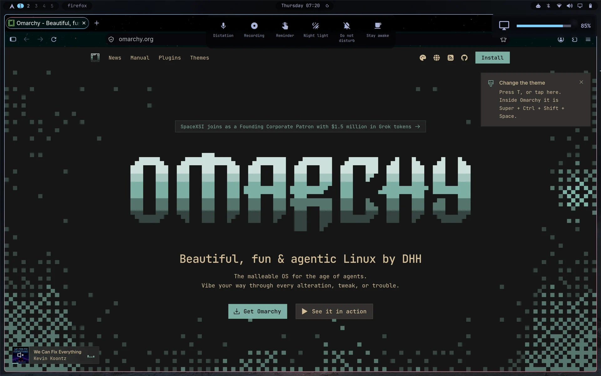 Clock hover panel and the brightness pop-up | 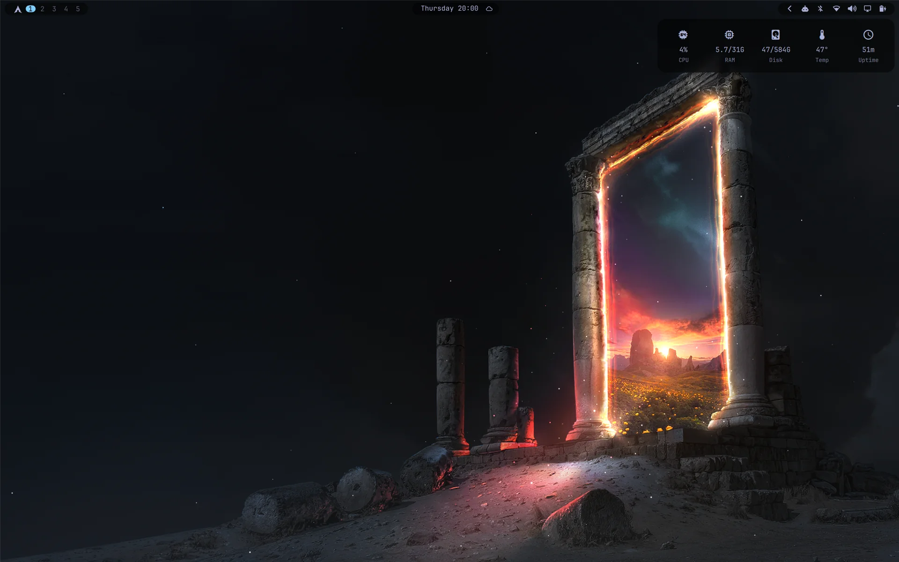 Stats flyout: CPU, memory, disk, temperature, uptime |
| 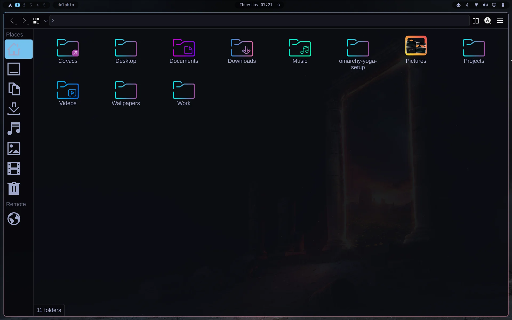 Dolphin with the Omarchy KDE theme and icon-only Places |  Catfish dropdown (`SUPER + D`) searching the whole drive |
|  Keybindings (`SUPER + K`), top-right |  System menu (`SUPER + ESCAPE`), bottom-left for touch |

### Tablet (the party)

| | |
|---|---|
| 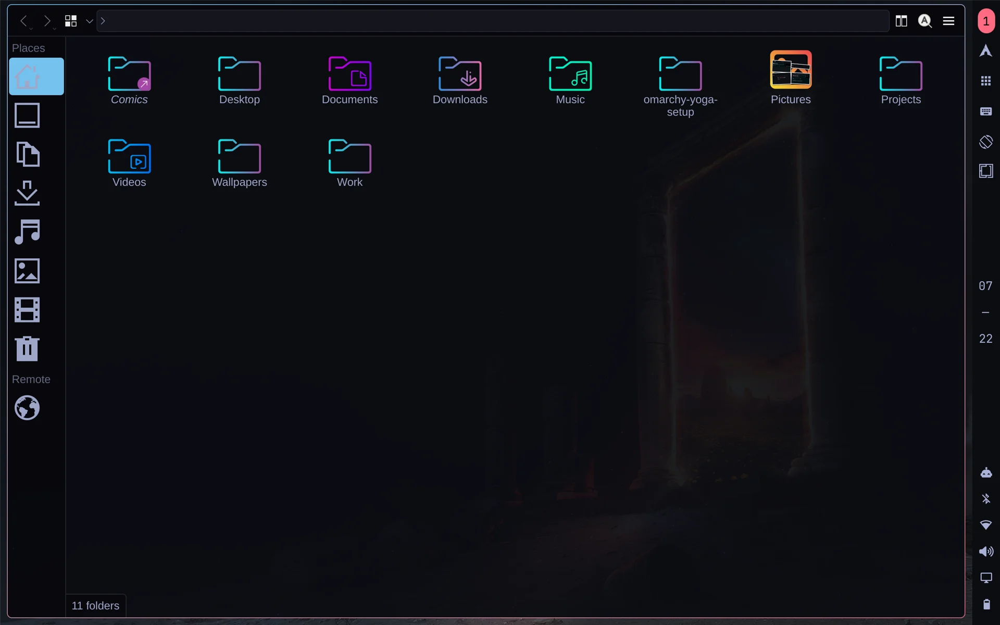 Tablet bar pinned to the right edge | 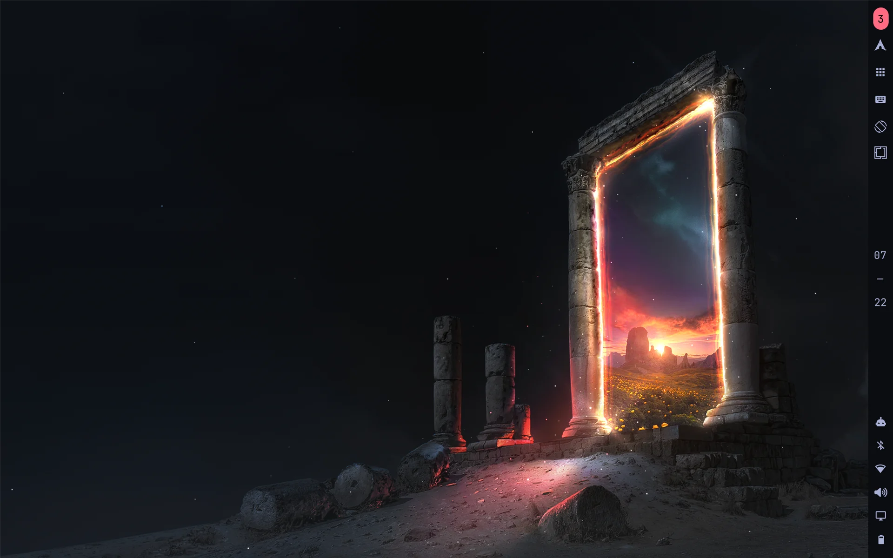 Tablet mode, nothing open |
| 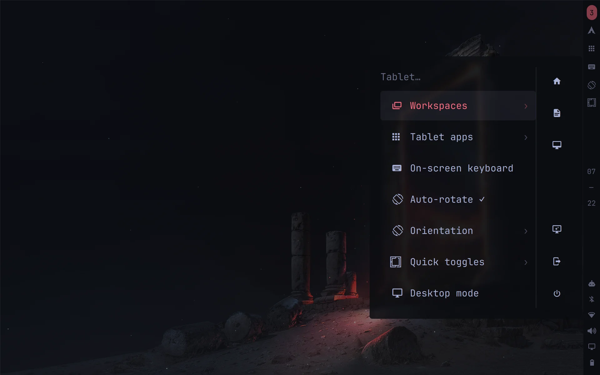 Tablet menu with its shortcut sidebar | 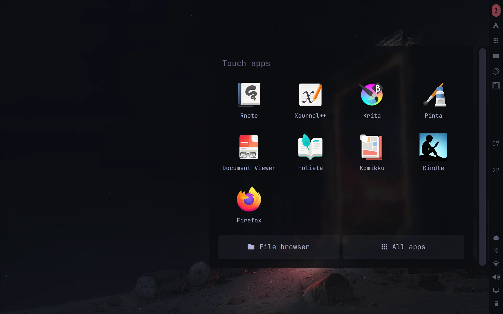 Touch app grid |
| 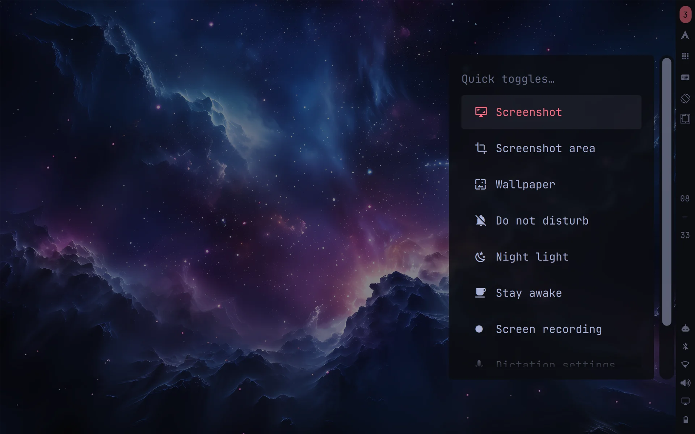 Quick toggles | 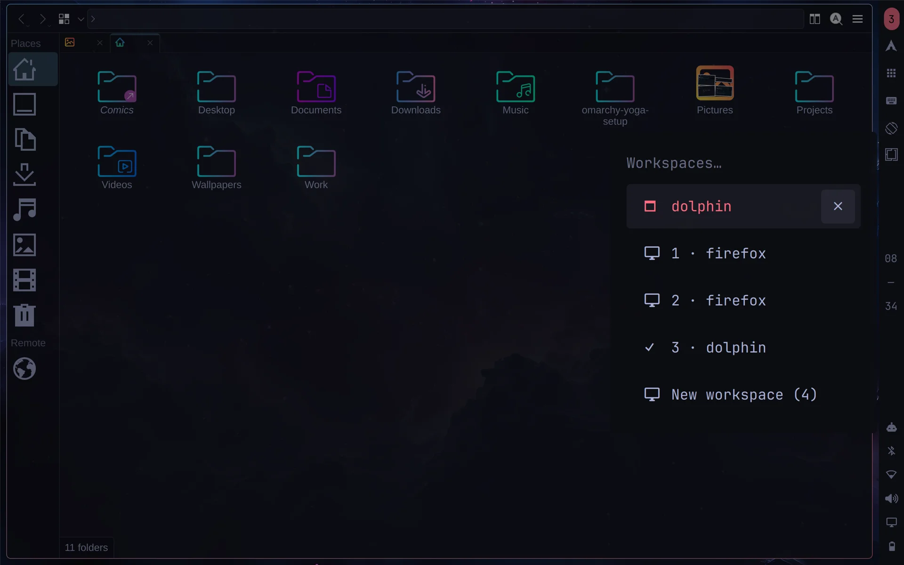 Workspace switcher |
| 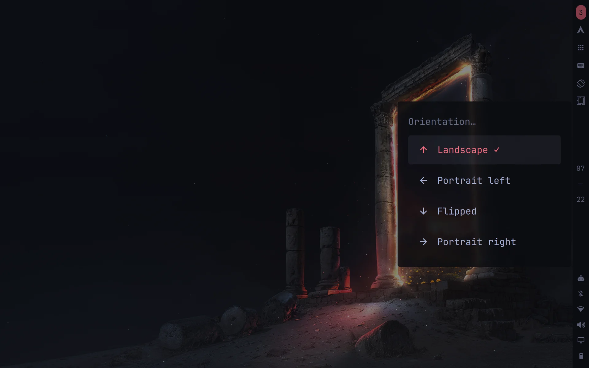 Orientation picker (hold the rotate button) | 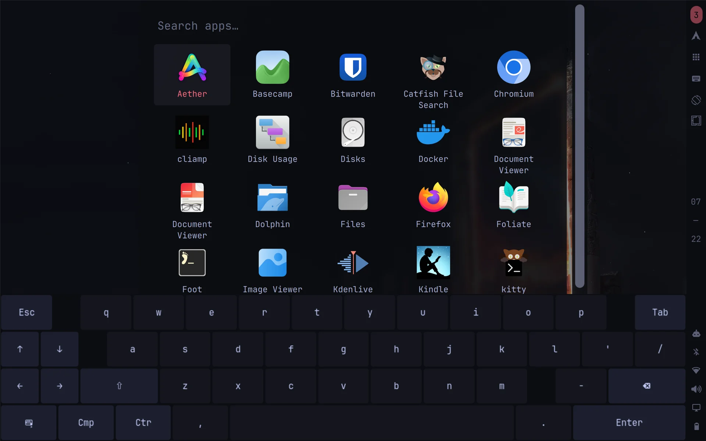 On-screen keyboard over the launcher |
| 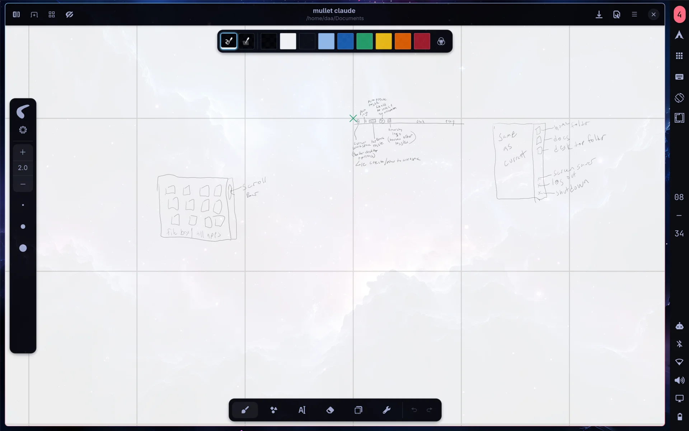 Rnote for the pen | 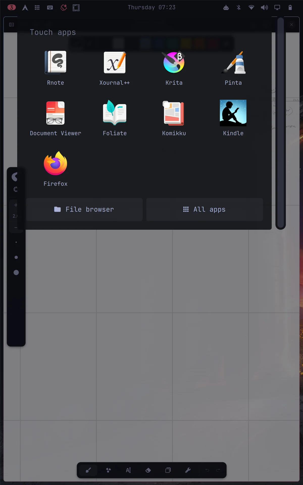 Portrait: the bar follows the panel's right edge |

---

## Repo layout

The folders mirror the home directory: `config/` is `~/.config` and `local/`
is `~/.local`. So `config/hypr/dropdowns.lua` lives at
`~/.config/hypr/dropdowns.lua`, and `local/bin/tablet-mode` at
`~/.local/bin/tablet-mode`.

---

## Desktop mode

### The bar (`daa.desktop-bar`)
A clone of Omarchy's bar, restyled as floating translucent "islands" with
blur behind them.

- **Left:** Arch logo (turns cyan on hover, click opens the Go menu,
  right-click opens a terminal), workspace dots, and an **app-name island**.
  Hover the app-name island for a list of every window per workspace,
  scratchpads included, and click one to jump to it.
- **Middle:** a **now-playing island** that only appears while media is
  playing. It lingers 5 s after playback stops.
- **Centre:** the clock island. Hover it and a **drop-down toggle panel**
  appears underneath: big icons with labels for Dictation, Screen recording,
  Reminder, Night light, Do not disturb and Stay awake. Toggles that are on
  sit on a cyan tile, and hovered tiles turn cyan. Toggles that are on also
  show as small icons next to the clock. (`daa.desktop-indicators`)
- **Right:** system icons. Hover the island for a **stats flyout** (CPU, RAM,
  disk, temperature, uptime). Click it to open btop in a dropdown.
- Turned off on purpose: dragging the bar to another screen edge, drag
  re-ordering widgets, and double-click to toggle transparency. All three
  were too easy to hit by accident.

### Look and feel
- All bar popups (calendar, weather, audio, network…), the volume and
  brightness pop-ups, and tooltips are **borderless**. The Go menu is too.
- Cyan accent theme overlay on Tokyo Night with darker backgrounds, and a
  cyan→coral gradient window border.
- Tuned gaps so windows line up with the floating bar.
- Launcher "pop" animation (90% → 105% → 100%).
- Nautilus: Backspace goes back a folder, via a small nautilus-python
  extension (`local/share/nautilus-python/extensions/backspace_back.py`).
- Screensaver dims the OLED to 20% and restores 80% on exit.

### Dropdown apps (`~/.config/hypr/dropdowns.lua`)
One key summons an app that slides down from the top. The same key hides it
again. Every dropdown is preloaded hidden at login, so the first press is
instant. Scripts and menus can summon one too:
`hyprctl eval 'dropdown_show("files")'` (or `dropdown_toggle`).

| Key | App |
|---|---|
| `SUPER + T` | Terminal (kitty) |
| `SUPER + C` | Claude Code |
| `SUPER + I` | btop |
| `SUPER + E` | Files (Nautilus); also the tablet menu's and app grid's Files buttons |
| `SUPER + P` | Bitwarden, pinned to the top-right corner and sliding in from the right |
| `SUPER + D` | Catfish file search over the whole drive (`/`, not just home) |

Each entry can set its size (`px` or screen fractions), pin itself to the
right edge (`right = 10`) and pick its own slide direction (`slide =
"slide"` comes in from the right). Hyprland can't give one special workspace
its own animation through workspace rules, so the style is switched just
before each toggle. `dropdown_relaunch(name, args)` restarts a dropdown with
extra arguments, which is how the menu's file search opens Catfish already
searching.

### Menus
- **Keybindings** (`SUPER + K`): borderless, hangs off the top-right corner
  and slides in from the right.
- **System / power menu** (`SUPER + ESCAPE`, power button): borderless, in the
  bottom-left corner, sliding in from the left. Escape is top-left on the
  keyboard, so the options are a short reach away on the touchscreen.
- **Clipboard** (`SUPER + V`, `daa.clipboard`): borderless, bottom-right,
  slides in from the right, with a **Clear all** button (asks first; same as
  `Shift + Delete`).
- **Re-press to close, other key to switch.** Every menu key goes through
  `~/.local/bin/menu-toggle`: pressing a menu's own key closes it, and
  pressing another menu's key switches straight to that menu. `daa.menu`
  records what it's showing in `$XDG_RUNTIME_DIR/omarchy-menu-open`. It also
  releases a script-driven list (like the keybindings list) when another
  menu replaces it, instead of leaving the script waiting forever.
- **File search from the Omarchy menu.** Type in the menu (`SUPER + SPACE`)
  and the last result row offers *Search all files* for what you typed. It
  runs `~/.local/bin/file-search`, which drops Catfish down already searching.

### Scratchpad behaviour (`~/.config/hypr/scratchpads.lua`)
- Clicking anywhere outside a scratchpad or dropdown hides it. So does
  focusing another window, or `SUPER + X`.
- New windows opened while a scratchpad is showing land on the normal
  workspace underneath, not inside the scratchpad.
- Guards stop double-clicks and closing bar panels from bringing a hidden
  scratchpad back (see [Known quirks](#known-quirks)).

### Workspaces (`~/.config/hypr/workspace_collapse.lua`)
Workspaces stay packed from 1. When one empties, the ones after it shift
down, and focus follows.

---

## Tablet mode

Folding the screen past 180° flips the **Lenovo Yoga Tablet Mode Control
switch**. Hyprland (`~/.config/hypr/tablet_mode.lua`) runs
`~/.local/bin/tablet-mode on`, and unfolding runs `tablet-mode off`. The
same script backs the tablet menu and buttons.

### What switching on does
- Turns off the keyboard and touchpad.
- Swaps the desktop bar for a separate **tablet bar** (`daa.tablet-bar`),
  50% bigger, pinned to the panel's physical right edge whichever way it's
  rotated.
- Starts **edge-swipe gestures** (lisgd), the **on-screen keyboard** (wvkbd,
  pops up on text fields) and **auto-rotation** (iio-sensor-proxy). Finger
  and pen input are remapped to match each rotation.
- Switches to **tablet-mode colours**: coral accent, borderless menus and
  notifications.
- Switches to the **tablet wallpaper**. Each mode remembers its own
  wallpaper: whatever you pick while in a mode sticks to that mode.

Unfolding puts everything back exactly as it was.

### The tablet bar
| Button | Tap | Hold |
|---|---|---|
| Arch logo | Tablet menu | |
| Apps | Touch app grid (4 columns, list in `~/.config/tablet-mode/apps`); its **File browser** button drops Files down like `SUPER + E` | |
| Workspace number | Workspace and window switcher (close windows with ✕, hide scratchpads) | |
| Keyboard | Show / hide the on-screen keyboard | |
| Rotate | Toggle the rotation lock (stays coral while locked) | Pick an orientation |
| Quick toggles | Screenshot, Screenshot area, **Wallpaper**, Do not disturb, Night light, Stay awake, Recording, Reminders | |
| Play / pause | Media | |

- Buttons light up when tapped and fade back after about a second, since a
  finger never "un-hovers".
- Scroll rails in menus, the launcher and the app grid sit on the
  **thumb side** (nearest screen edge). The handle lights up coral while
  you drag it.

### Gestures (`~/.config/tablet-mode/gestures`)
| Gesture | Action |
|---|---|
| Swipe down from the top edge | Tablet menu |
| Swipe up from the bottom edge | On-screen keyboard |
| Swipe in from the left edge | App launcher |
| Swipe in from the right edge | Close the focused window |
| Three-finger swipe left / right | Next / previous workspace |

### Tap the wallpaper to tidy up
A single tap on empty wallpaper (`daa.background`) runs `tablet-mode dismiss`.
That hides the keyboard, scratchpads, menus, launchers, bar popups and the
tray drawer. In tablet mode, double-tapping the wallpaper no longer opens the
wallpaper picker; use the Quick toggles button instead.

### Reading
Papers for PDFs, Foliate for EPUB and comics, Komikku as a comic library,
Kindle as a web app, Rnote, Xournal++ and Krita for the pen.
`~/.local/bin/comic-open` opens CBZ files straight in Foliate and repacks
CBR to CBZ first. CBR needs `unrar`.

---

## Shared pieces

These work in both modes and adapt to tablet mode on their own:

| Plugin | Role |
|---|---|
| `daa.menu` | Every menu: Go menu, tablet menu, Quick toggles, workspace switcher. Opens against the bar, has a touch back-arrow and a shortcut sidebar (Home, Documents, Desktop, Screensaver, Log out, Shut down) |
| `daa.launcher` | App launcher, with a scroll rail in tablet mode |
| `daa.osd` | On-screen display |
| `daa.background` | Wallpaper renderer, plus tap-to-dismiss in tablet mode |
| `daa.clipboard` | Clipboard manager: borderless, bottom-right, Clear all button |

---

## Theming Qt, KDE and Catfish

Everything follows the Omarchy theme and is regenerated on every theme change
through Omarchy's own template system (`~/.config/omarchy/themed/*.tpl`) and a
`theme-set` hook.

**Qt and KDE apps** (Dolphin, Kdenlive…):
- `QT_QPA_PLATFORMTHEME=qt6ct` (set in `looknfeel.lua`; Omarchy's default
  is `gtk3`, which gives KDE apps little more than light or dark), with the
  Breeze style. Needs `qt6ct` and `breeze`.
- `themed/kde.colors.tpl` is a KDE color scheme and `themed/qt6ct-colors.conf.tpl`
  a qt6ct palette, both mapped from the theme's named colors. Sidebars and
  toolbars use the darker `dark_background`, file views the normal
  `background`, like Nautilus.
- `hooks/theme-set.d/kde-qt-theme` merges the scheme into `kdeglobals`, links
  it as the "Omarchy" color scheme, writes `qt6ct.conf`, and pre-selects
  Omarchy in each installed KDE app's own settings (KDE apps read their scheme
  choice from their own rc file, not `kdeglobals`).
- It also builds a small `Omarchy-Qt` icon theme on top of the Omarchy one:
  light outline icons for Dolphin's Places sidebar (Breeze's, recoloured to
  the theme foreground, since KDE only recolours icons on Plasma), with
  `breeze-dark` or `breeze` filling the gaps to match light or dark themes.
- Tip: Dolphin won't accept an empty name for a Places entry, but a
  zero-width space works, giving icon-only entries.

**Catfish** is GTK 3. It gets its own theme, `Omarchy-Catfish`
(`themed/catfish-gtk3.css.tpl`, dark Adwaita plus Dolphin-style colours),
and only the `SUPER + D` dropdown launches it with
`GTK_THEME=Omarchy-Catfish`. Other GTK apps are untouched. (GTK 3 only lets
CSS target a window by name if the app sets one, and Catfish doesn't.)

---

## Hardware fixes for the Yoga 9 14IPH11

| Problem | Fix |
|---|---|
| **Brightness keys do nothing.** The OLED wants DPCD AUX backlight; the firmware says PWM. | Kernel option `xe.enable_dpcd_backlight=1` (Limine: drop-in in `/etc/limine-entry-tool.d/`, then `sudo limine-update`). |
| **No rotation sensor.** ISH firmware is rejected. | Use the Yoga's own signed ISH firmware from its Windows install (DriverStore `ishheciextensiontemplate.inf_*/FwImage/0004/PTL_ishS_SI.bin`), installed as `/lib/firmware/updates/intel/ish/ish_ptl_<crc32 of "83SE">_<vendor crc>.bin.zst`. **Extract your own copy; don't redistribute the blob.** |
| **PrtSc does nothing.** The key sends `XF86SelectiveScreenshot`. | Bind that keysym to `omarchy-capture-screenshot region`. |
| **No speakers ("Dummy Output").** A ghost SoundWire device. | Fixed upstream in kernel **7.3** ("soundwire: dmi-quirks: add a global ghost list"). Waiting for Omarchy's 7.3 kernel. |
| **Windows not in the Limine menu.** It's on a separate ESP. | Add a manual `/Windows` EFI chainload entry to `/boot/limine.conf`. |

---

## File map

**Desktop only** (`daa.desktop-*`): `daa.desktop-bar`,
`daa.desktop-arch-menu`, `daa.desktop-workspaces`, `daa.desktop-app-name`,
`daa.desktop-media`, `daa.desktop-indicators`.

**Tablet only** (`daa.tablet-*`): `daa.tablet-bar`, `daa.tablet-menu`,
`daa.tablet-workspace`, `daa.tablet-apps`, `daa.tablet-apps-grid`,
`daa.tablet-keyboard`, `daa.tablet-rotate`, `daa.tablet-quick`,
`daa.tablet-media`.

**Shared:** `daa.menu`, `daa.launcher`, `daa.osd`, `daa.background`,
`daa.clipboard`.

| Path | Mode | Purpose |
|---|---|---|
| `~/.config/omarchy/plugins/` | both | Shell plugins above (also has its own `README.md` map) |
| `~/.config/omarchy/shell.json` | both | Bar layout and enabled plugins |
| `~/.config/omarchy/shell.toml` | both | Theme overrides (borderless popups and tooltips) |
| `~/.config/omarchy/extensions/omarchy-menu.jsonc` | both | Menu entries (`tablet.*` = tablet) |
| `~/.config/omarchy/themed/` | both | Theme templates: GTK, Firefox, KDE, qt6ct, Catfish, shell |
| `~/.config/omarchy/themes/tokyo-night/` | both | Theme overlay: cyan accent, darker backgrounds |
| `~/.config/omarchy/hooks/theme-set.d/kde-qt-theme` | both | Applies the Qt/KDE theme on every theme change |
| `~/.local/bin/menu-toggle` | both | Menu keys: re-press closes, other key switches |
| `~/.local/bin/file-search` | both | Opens the Catfish dropdown searching for its arguments |
| `~/.config/hypr/dropdowns.lua`, `scratchpads.lua`, `workspace_collapse.lua`, `screensaver_brightness.lua`, `looknfeel.lua`, `bindings.lua` | both | Hyprland behaviour |
| `~/.config/hypr/tablet_mode.lua` | tablet | Fold switch → `tablet-mode on/off` |
| `~/.local/bin/tablet-mode` | tablet | The switcher (run with no arguments for usage) |
| `~/.config/tablet-mode/gestures`, `apps` | tablet | Gestures and the app-grid list |
| `~/.local/share/tablet-setup/setup-tablet.sh` | tablet | One-time package and permission setup |

---

## Installing

1. Install Omarchy, and check that `hyprctl version` reports a Lua-config
   Hyprland.
2. Copy the folders above into place. If your username isn't `daa`, rename
   the `daa.*` plugin folders, the ids inside their `manifest.json` files,
   and the ids in `shell.json`, all to match.
3. Tablet extras: run `setup-tablet.sh`. It installs `iio-sensor-proxy`,
   `lisgd` and `wvkbd` (AUR), the reading and drawing apps, and adds you to
   the `input` group. Log out and back in afterwards.
4. Desktop extras: `qt6ct`, `breeze`, `catfish` and `bitwarden` from the
   official repos.
5. Apply the hardware fixes your machine needs.
6. Run `omarchy restart shell`, then `hyprctl reload`, and re-apply your
   theme (`omarchy theme set "<theme>"`) so the templates and hook run.

The tablet bits are written for this model's device names (keyboard
`at-translated-set-2-keyboard`, Cirque touchpad, Wacom `wacom-hid-544c`
touch and pen, panel `eDP-1`). Change the variables at the top of
`tablet-mode` for other 2-in-1s.

---

## Known quirks

- **Clones don't get upstream updates.** The bars, menu, launcher, OSD,
  background and indicators are copies of Omarchy's built-ins. After big
  Omarchy updates, compare them with the originals in
  `/usr/share/omarchy/shell/` and port any fixes you want.
- **Scratchpad flash.** On an empty workspace, closing a bar panel can make a
  hidden scratchpad flash for a split second before it's hidden again.
  Hyprland hands focus back to it when nothing else can take it.
- **No sound from the speakers yet.** The audio shows as "Dummy Output"
  because of a ghost SoundWire device. It's fixed upstream in kernel 7.3, and
  this machine is on 7.2, so it's waiting on Omarchy shipping a 7.3 kernel.
  (See the hardware table.)
- **Shell log noise.** Swapping bars logs harmless `Cannot read property …
  of null` warnings while widgets unload. Omarchy's own panels do the same.
- **Comics.** Komikku can't open a file by path, so `comic-open` sends files
  to Foliate instead.
- **Bitwarden looks black in screenshots.** That's its screen-capture
  protection, not a rendering bug.
- **Dolphin's sidebar highlight** is solid accent for a moment after launch
  (and while clicking), because the Places panel has keyboard focus then.

---

## Mullet Claude

Where it started: the original pen sketches for tablet mode, drawn in Rnote.
The touch app grid with its scroll bar and File browser / All apps buttons,
the tablet bar (workspace, Arch logo, keyboard, rotate, Omarchy toggles,
clock, tray), and the tablet menu with its Home / Docs / Desktop and
Screensaver / Log out / Shut down sidebar.

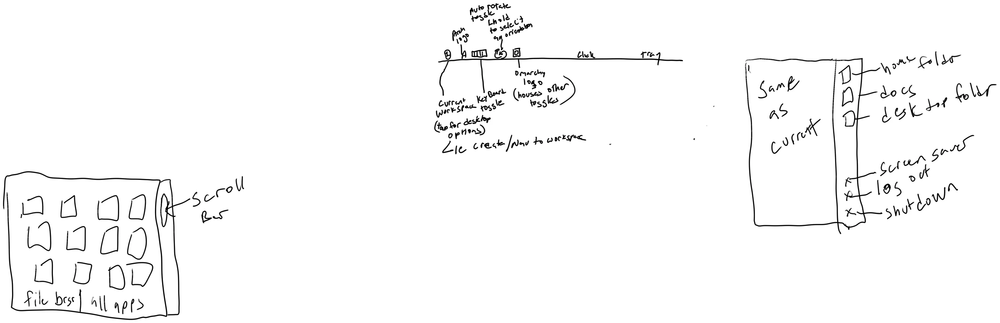
